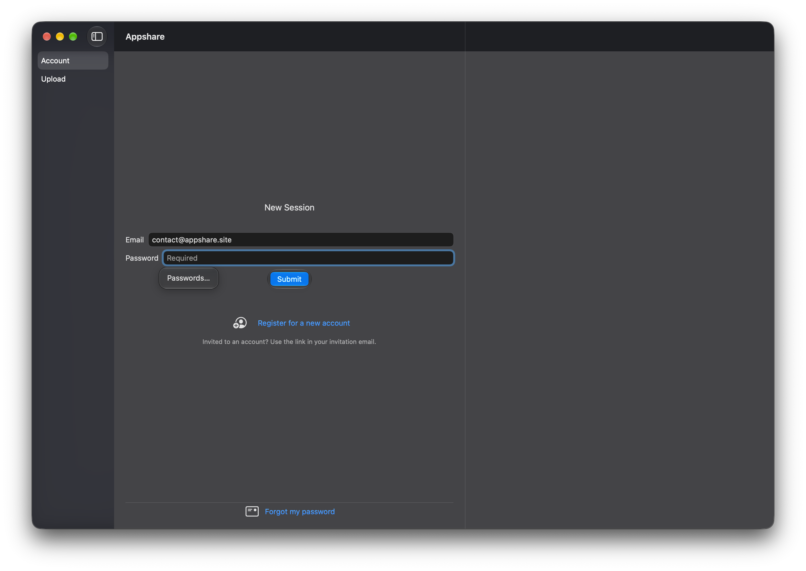
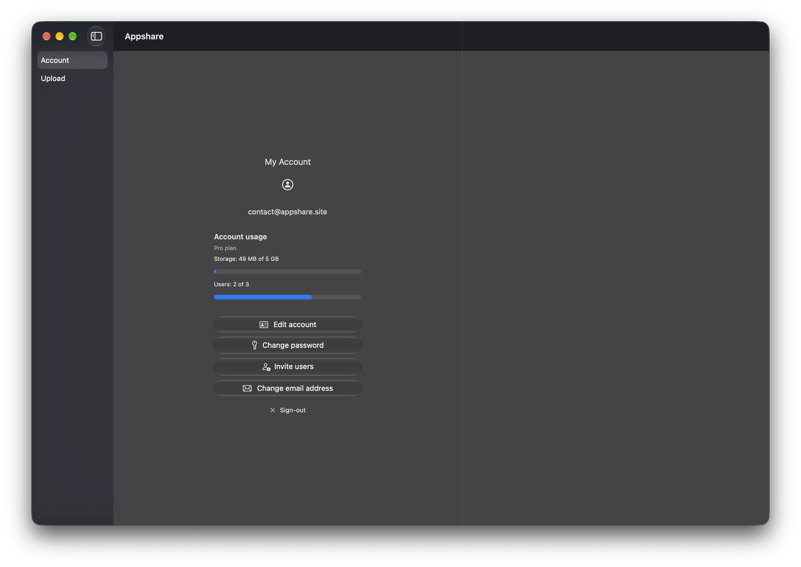
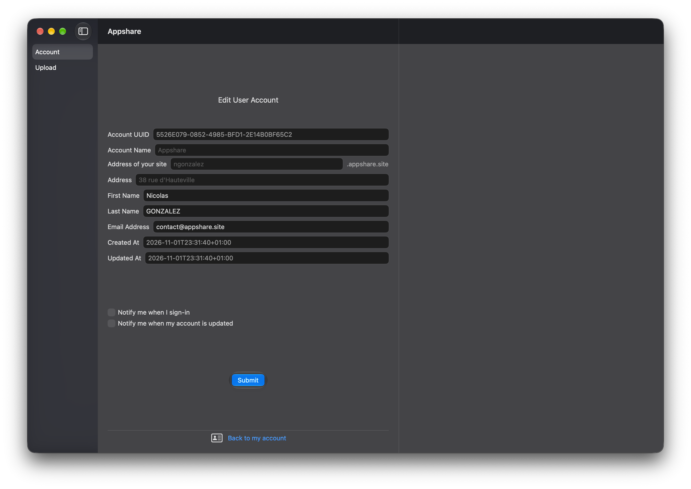
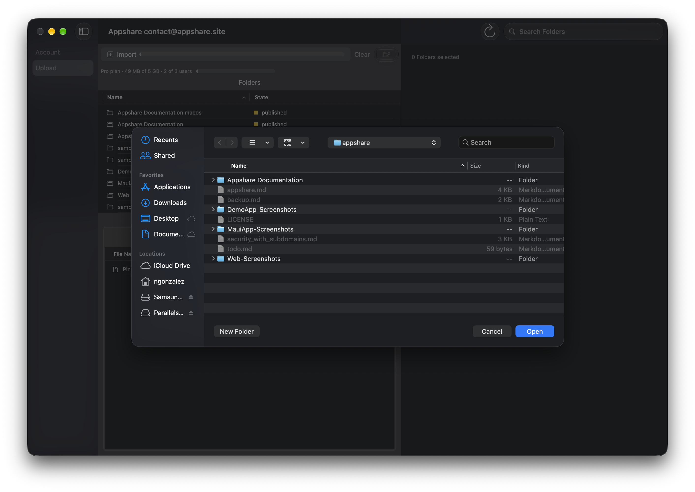
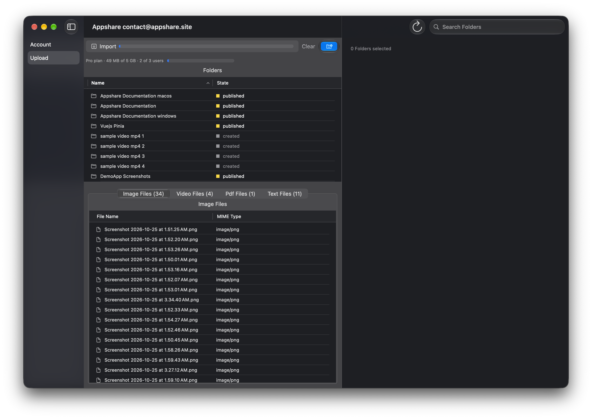
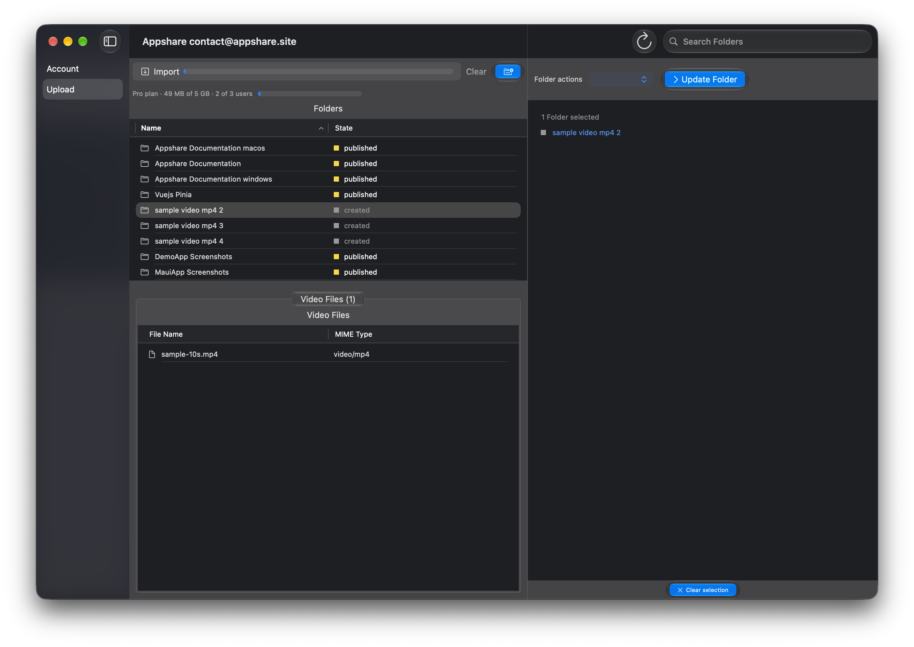
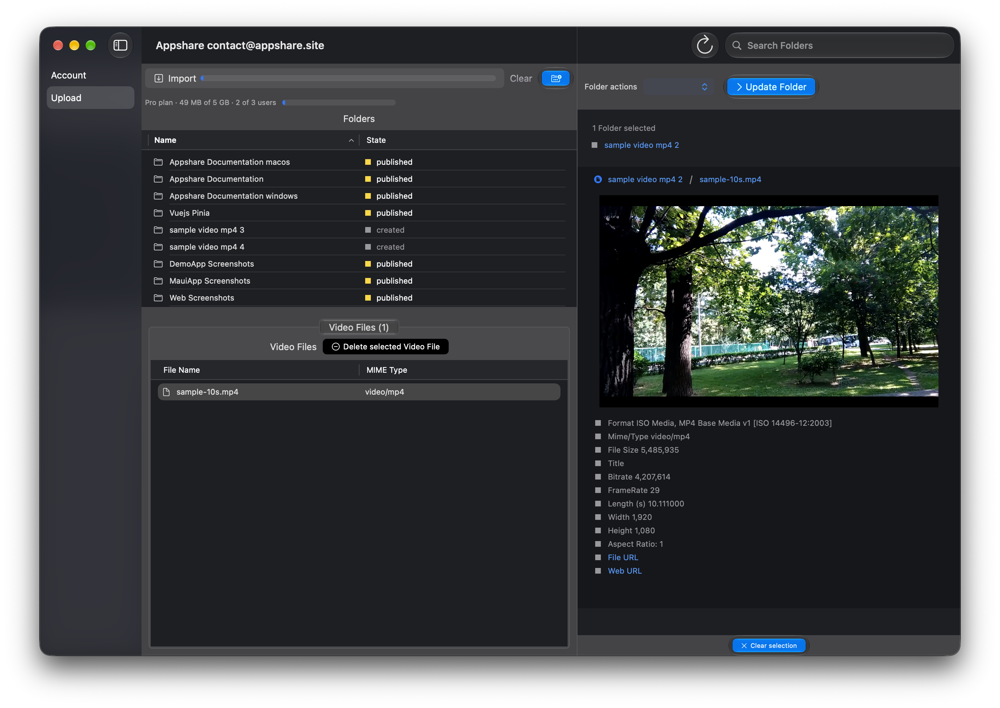

#### macOS: Install client application

Install the macOS client application

### List of topics

- Install the macOS client application
- Create an account, or join one
- Sign-in with the desktop application
- Access your account
- Edit your account
- Invite users
- Upload files
- Your folders and files

#### Install the macOS client application

Install the macOS client application

#### Create an account, or join one

A new account is created on [register.appshare.site](https://register.appshare.site): choose your plan, Pro or Business, and pay securely with Stripe. Your account is created once the payment succeeds. The application's "Register for a new account" link opens that page.

To join an existing account, ask one of its users to invite you: follow the link in the invitation email, then choose your name and password.

#### Sign-in with the desktop application

Submit your email address and password to create a new login session with Appshare

 

#### Access your account

Access your account page by clicking the Account tab in the left sidebar: your plan, how much storage your files take, and how many users the account has

 

#### Edit your account

Click "Edit account" to change your name, your email address and your notifications

 

#### Invite users

Click "Invite users" on your account page and enter an email address: the person receives an invitation to join your account, valid for 7 days. Your plan sets how many users the account may have: 3 for Pro, 10 for Business.

#### Upload files

Click the Upload tab, then Import, and choose the files or the folder to upload

 

#### Your folders and files

Your folders, created or published, and their files by type

 

Select a folder to see its files and change it: publish it, archive it or delete it

 

Select a file to preview it and read its details

 

